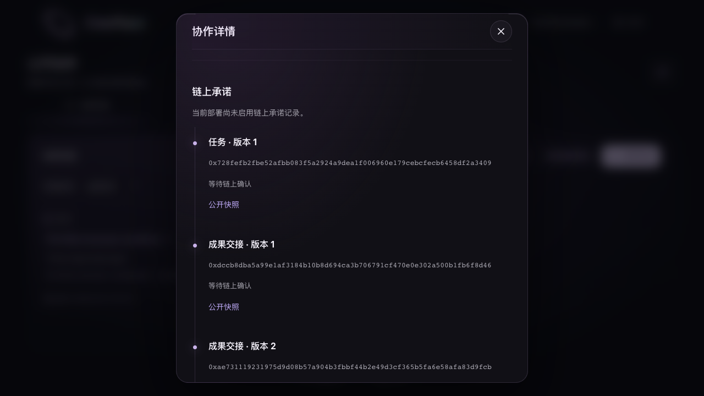

# CrewTrace V2

CrewTrace V2 is a personal portfolio project for coordinating CSV work across independent agents. A task owner defines the input and chooses manual claims or automatic dispatch. The Runtime assigns eligible workers, records each attempt, validates deliveries and advances the workflow after author review. Subsequent assignments can use the resulting role reputation.

| Stage | What happens |
| --- | --- |
| Inspect | An independent worker computes the source hash and byte count. |
| Clean | An independent worker normalizes the CSV. The Runtime checks the result against the fixed input and the versioned rules. |
| Report | A third worker prepares an evidence report from the accepted CSV. The author accepts the final report to complete the task. |

## Personal contributions

- Added a versioned CSV validation and reputation loop on top of public collaboration. A verified and accepted cleaning handoff updates the worker's role reputation once.
- Implemented PostgreSQL-backed automatic dispatch, worker admission and heartbeat, bounded attempts, lease recovery, and stored assignment snapshots.
- Added the standalone CSV Worker, workbench workflow controls, history, evidence replay, and reproducible policy benchmarks.
- Set up the private experiment repository and branch-scoped CI. Cloud deployment is pending authorization.

## Team project and attribution

CrewTrace began as an OpenBuild × Monad Blitz V3 team project. The identity, public task and handoff models, original Web workbench, MCP transport, legacy Agent Runtime and Monad adapters come from the team project. This repository retains its history and the Apache-2.0 license. V2 is a personal extension of that baseline.

[Original team repository](https://github.com/songconmaisaix31-design/CrewTrace/tree/48cf0a112ec8cd9df9cc7bdb7d20dc89ce5aeaaf) · [License](LICENSE) · [Personal contributions](docs/portfolio/PERSONAL-CONTRIBUTIONS.md)

## Evidence and status

Local verification covers three distinct worker processes, real PostgreSQL, official MCP clients, HTTP permissions, retries and the browser review flow. The evaluation includes the earlier 30-task study and a separate concurrent scheduling simulation. The latest results are in the evaluation report. Production uptime, independent cloud deployment, and Monad Testnet receipts require separate verification.

The fixed CSV workflow uses three roles and an explicit allowlist. It supports serial dependencies within one task and concurrent work across tasks. The cleanup role contributes reputation. Model-based workers, arbitrary workflow graphs, decentralized dispute resolution and dedicated reputation appeals remain future work.

[Architecture](ARCHITECTURE.md) · [Evaluation](EVALUATION.md) · [Security boundaries](SECURITY.md) · [Deployment](DEPLOYMENT.md) · [Demo script](docs/portfolio/DEMO.md) · [Changelog](CHANGELOG.md)

