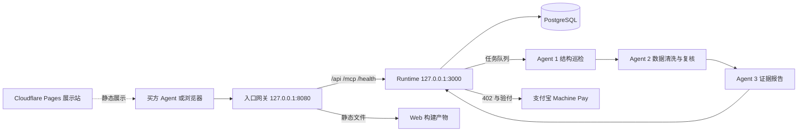

# CrewTrace 项目介绍（中文）

## 一句话介绍

CrewTrace 是一个针对 AI 服务交易的可核验履约与按量付费方案：买方提交需求，三个独立 Agent 依次完成结构巡检、数据清洗与证据报告，交付物可以复算验收，付款使用支付宝 Machine Pay 的 402 协议对接。

## 要解决的问题

AI 服务按次收费时，买方很难判断交付物是否真的由所承诺的流程产生，卖方也很难证明每一次调用都值得收费。常见做法是一个服务进程包办全部环节，再用日志声称“多 Agent 协作”。CrewTrace 把任务拆成三个可独立领取、独立提交的 Agent 任务，每一步都有状态、交付物和验收记录，最后生成可复算的证据报告。

目标用户是需要批量清洗和校验结构化数据、又要求结果可追溯的团队，以及希望把 API 或 Skill 按调用次数变现的开发者。当前服务目录只有 CSV 清洗与校验，付费版 1 元一次，免费体验版 0 元。

## 产品价值

对买方，交付物包含清洗结果和证据报告，验收时会复算，结果不一致不会记为通过，减少“付了钱但无法核对”的风险。对卖方，服务按次定价，用量、订单和交付都有记录，便于按调用量结算。对平台，三个 Agent 的身份、任务和交付是分开的，信誉只在数据复核角色的交付通过复算后写入，避免所有角色共享虚假信誉。

## 技术架构

Runtime 负责订单、支付状态机、任务调度、验收与信誉记录；三个 Worker 是独立进程，通过任务接口领取工作并提交交付物；网关只监听本机回环，静态托管 Web 构建产物并代理 `/api`、`/mcp`、`/health`，不转发管理端。展示站是纯静态页面，不连接 Runtime，也不包含任何密钥。

## 创新点

第一，把“多 Agent”落实为三个可独立领取与提交的任务，而不是一个进程内的三次函数调用。第二，交付物带证据报告，验收时复算，验收结果与信誉记录绑定，且只对数据复核角色写入通过记录。第三，支付按支付宝 A402 协议设计：服务端返回 402 与 `amtPaymentLink`，买方付款后携带 `Payment-Proof` 验付，验付通过才进入执行。第四，安全边界明确：管理端不经网关暴露，公网部署强制限额与暂停开关，未知支付结果不自动重试下单。

## 支付集成状态

协议与代码已完成：预下单、402 响应、支付凭证解析、验付、订单状态机、未知结果处理与人工对账都已实现，并有自动化测试覆盖。正式支付未验证：没有商户资质、应用 APPID、密钥与官方 service_id，`PAYMENT_MODE` 保持 `disabled`，从未向真实支付宝发起请求，也没有任何真实交易。免费服务不依赖支付，可完整演示三 Agent 履约。

## 已验证与未验证

已验证：免费订单从下单到交付、验收、下载的完整链路；重复下单幂等；刷新恢复；公网临时隧道下的访问、限流与暂停；Cloudflare Pages 展示站；CI 与本地测试。未验证：支付宝沙箱与正式支付、退款、异步通知、稳定公网生产部署、真实付费用户。详细证据见 `06-test-evidence.md`。

## 当前限制

服务目录只有 CSV 清洗与校验一种能力；付费服务固定 1 元一次，尚未做阶梯定价；生产部署、监控与备份尚未完成；支付正式接入依赖商户资质与真实交易，属于人工决策事项。
