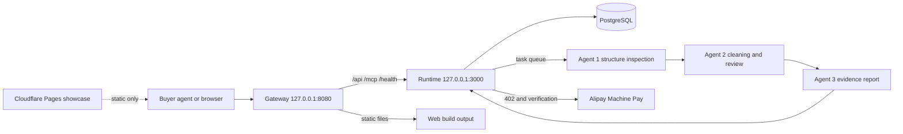

# CrewTrace — Project Introduction (English)

## One-line summary

CrewTrace is a verifiable fulfillment and pay-per-use layer for AI services. A buyer submits a task, three independent agents inspect structures, clean and verify the dataset, and produce an auditable evidence report. Payment is designed around Alipay Machine Pay's HTTP 402 flow.

## Problem

When AI services charge per call, buyers cannot easily verify that a deliverable was produced by the process the seller claims, and sellers cannot easily prove that each call deserves payment. A common shortcut is one process performing all steps while calling itself "multi-agent." CrewTrace splits the work into three separately claimed and separately submitted agent tasks, each with its own state, deliverable and acceptance record, ending with a recomputable evidence report.

The target users are teams that need repeatable cleaning and validation of structured data with traceability, and developers who want to monetize APIs or skills per invocation. The current catalog contains one CSV cleaning and validation service: CNY 1.00 per paid run, plus a free demonstration service at CNY 0.

## Value

For buyers, the deliverable includes the cleaned dataset and an evidence report; acceptance recomputes the result and does not record a pass when values differ. For sellers, per-call pricing is backed by order, usage and delivery records. For the platform, identities, tasks and deliverables are separate, and reputation is written only when the data-review role's delivery passes recomputation, so other roles cannot inflate reputation.

## Architecture

The runtime owns orders, the payment state machine, task scheduling, acceptance and reputation. The three workers are separate processes that claim tasks and submit deliverables. The gateway listens on loopback only, serves the web build and proxies `/api`, `/mcp` and `/health`; it never forwards the admin endpoint. The showcase site is static, has no runtime dependency and contains no secrets.

## Innovation

First, multi-agent work is modeled as three independently claimed and submitted tasks rather than three function calls inside one process. Second, each delivery carries an evidence report that acceptance recomputes, and reputation is bound to that result for the data-review role only. Third, payment follows Alipay's A402 design: the service returns 402 with an `amtPaymentLink`, the buyer returns with a `Payment-Proof`, and execution starts only after verification. Fourth, the security boundary is explicit: admin routes are not exposed through the gateway, public deployment requires rate limits and a pause switch, and unknown payment results never trigger an automatic second charge.

## Payment status

The protocol and code are implemented: pre-ordering, the 402 response, proof parsing, verification, the order state machine, unknown-result handling and manual reconciliation are covered by automated tests. Official payment is not verified: there is no merchant qualification, app ID, key pair or official service ID, `PAYMENT_MODE` remains `disabled`, no request has ever been sent to Alipay, and there are no real transactions. The free service is fully demonstrable without payment.

## Verified and unverified

Verified: the free order flow from creation to delivery, acceptance and download; idempotent re-submission; state recovery after refresh; public access, rate limits and pause behavior through a temporary tunnel; the Cloudflare Pages showcase; CI and local tests. Unverified: Alipay sandbox and production payments, refunds, asynchronous notifications, a stable public production deployment, and real paying users. Evidence is listed in `06-test-evidence.md`.

## Origin and attribution

CrewTrace began as an OpenBuild × Monad Blitz V3 team project. The identity, public task and handoff models, original web workbench, MCP transport, legacy agent runtime and Monad adapters come from the team project; this repository retains the original commit history and the Apache-2.0 license. The V2 personal extension adds the fixed CSV workflow, PostgreSQL dispatch, standalone workers, recomputable evidence, reputation, benchmarks and the payment flow, as listed in `docs/portfolio/PERSONAL-CONTRIBUTIONS.md` and the repository README. Team authorization must be confirmed before competition submission or commercial use.

## Current limitations

The catalog currently offers only CSV cleaning and validation; the paid service is fixed at CNY 1.00 per run with no tiered pricing; production monitoring and backup are not complete; official payment depends on merchant qualification and a real transaction, which require a human decision.
