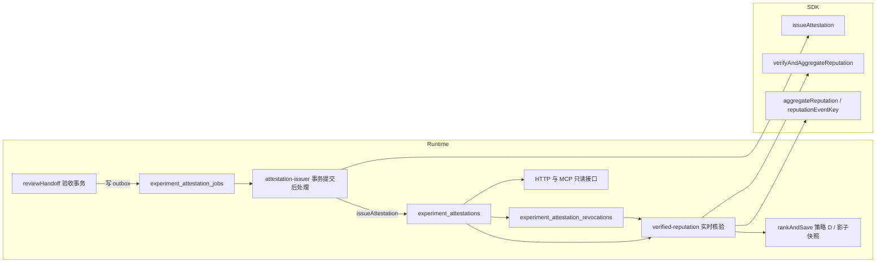

# V3 技术规格：Trust-Native Agent Collaboration

状态：`PENDING_APPROVAL`

适用分支：`feat/trust-native-collaboration`，基线 `8b5fe58e80450561829e62572aef128465492aa0`。

本规格按 M1 → M2 → M3 → M4 顺序实施，每个模块通过本节「验收」后进入下一模块。任何模块无法打通真实 Runtime 协作闭环时停止后续 UI 与功能扩展，保留失败证据。

## 1. 总体架构



Runtime 只新增一个信任适配目录 `services/runtime/src/trust/`，不重写 SDK，不新增验证器。SDK 只做一处最小改动：`IssueFactsSchema.source.kind` 增加 `crewtrace-collaboration-task`，并把 `orderId` 改为可空（对既有两种来源保持必填），用于表达协作任务没有订单编号这一事实。

## 2. 配置

在 `services/runtime/src/config.ts` 增加字段，全部为实验配置：

| 变量 | 默认值 | 说明 |
| --- | --- | --- |
| `TRUST_ATTESTATION_ENABLED` | `false` | 关闭时不写 outbox、不签发、不校验 |
| `TRUST_ISSUER_ID` | `ct-local-experiment` | 实验签发主体标识 |
| `TRUST_KEY_ID` | `local-exp-1` | 实验密钥标识 |
| `TRUST_ISSUER_PRIVATE_KEY` | 无 | 32 字节十六进制，启用时必填 |
| `TRUST_ORDER_SALT` | 无 | 至少 32 字符，启用时必填 |
| `TRUST_BUYER_SALT` | 无 | 至少 32 字符，启用时必填 |
| `TRUST_DEPLOYMENT` | `crewtrace-local-experiment` | 写入凭证 `binding.deployment` |
| `TRUST_ENVIRONMENT` | `local` | 只允许 `local` |
| `TRUST_ATTESTATION_MAX_ATTEMPTS` | `3` | 单次处理的最大重试轮数 |
| `EXPERIMENT_MATCHING_POLICY` | `C_RUNTIME_REPUTATION` | `A_RANDOM`、`B_CAPABILITY`、`C_RUNTIME_REPUTATION`、`D_VERIFIED_REPUTATION` |
| `EXPERIMENT_MATCHING_MODE` | `off` | `off` 或 `shadow` |

`superRefine` 增加三条约束：启用签发时密钥与两个盐必填；选择 `D_VERIFIED_REPUTATION` 或影子模式时必须启用签发；`PUBLIC_DEPLOYMENT=true` 时禁止非默认策略与影子模式。

## 3. 数据库迁移

新增 `services/runtime/migrations/016_trust_attestations.sql`：

```sql
CREATE TABLE experiment_attestation_jobs (
  claim_id text PRIMARY KEY REFERENCES collaboration_claims(id),
  task_id text NOT NULL REFERENCES collaboration_tasks(id),
  attestation_id uuid NOT NULL UNIQUE,
  status text NOT NULL CHECK (status IN ('PENDING','ISSUING','ISSUED','FAILED')),
  attempts integer NOT NULL DEFAULT 0 CHECK (attempts >= 0),
  last_error text,
  created_at timestamptz NOT NULL DEFAULT now(),
  updated_at timestamptz NOT NULL DEFAULT now(),
  issued_at timestamptz
);
CREATE INDEX experiment_attestation_jobs_status ON experiment_attestation_jobs(status, created_at);

CREATE TABLE experiment_attestations (
  attestation_id uuid PRIMARY KEY,
  claim_id text NOT NULL UNIQUE REFERENCES experiment_attestation_jobs(claim_id),
  task_id text NOT NULL REFERENCES collaboration_tasks(id),
  agent_id text NOT NULL REFERENCES collaboration_agents(id),
  role text NOT NULL,
  issuer_id text NOT NULL,
  key_id text NOT NULL,
  environment text NOT NULL,
  deployment text NOT NULL,
  rule_id text NOT NULL,
  rule_version text NOT NULL,
  event_key text NOT NULL UNIQUE,
  outcome text NOT NULL CHECK (outcome IN ('PASS','FAIL')),
  digest text NOT NULL,
  document jsonb NOT NULL,
  issued_at timestamptz NOT NULL,
  created_at timestamptz NOT NULL DEFAULT now()
);
CREATE INDEX experiment_attestations_agent_role ON experiment_attestations(agent_id, role);

CREATE TABLE experiment_attestation_revocations (
  attestation_id uuid PRIMARY KEY REFERENCES experiment_attestations(attestation_id),
  reason_code text NOT NULL CHECK (char_length(reason_code) BETWEEN 1 AND 64),
  revoked_at timestamptz NOT NULL DEFAULT now()
);
```

`experiment_reputation_events` 不新增列，不迁移历史数据。凭证与信誉事件通过 `claim_id` 一对一关联。

## 4. M1：自动履约凭证

### 4.1 新增文件

`services/runtime/src/trust/trust-environment.ts`

- `loadTrustEnvironment(config)`：启用时用 `privateKeyToAccount` 推导签名地址，返回 `{ enabled, issuerId, keyId, address, privateKey, environment, deployment, orderSalt, buyerSalt, maxAttempts }`。未启用返回 `{ enabled: false }`。启用但缺少密钥或盐时在这里抛出错误，由 `config.ts` 的校验提前阻断。
- `attestationAllowlist(env, now)`：在内存中构造 `ct-issuer-allowlist-v1`，`issuedAt=now`、`expiresAt=now+24h`，只包含实验签发者。
- `attestationRevocations(rows, now)`：从撤销表构造 `ct-revocation-list-v1`，`issuedAt=now`、`expiresAt=now+1h`。
- `attestationTrustPolicy(env)`：构造 `ct-trust-policy-v1`，`trustRoot.kind=CONTROLLED_LOCAL_CONFIG`、`independentlyCertified=false`，`recognizedRuleVersions=['csv-ledger-v1']`，`expectedBinding` 与签发一致，`requireRevocations=true`，信誉策略使用 `DEFAULT_REPUTATION_POLICY`。

`services/runtime/src/trust/attestation-issuer.ts`

- `enqueueCsvAttestation(client, taskId, claimId, env)`：签发条件全部满足才插入 outbox，`ON CONFLICT (claim_id) DO NOTHING`。
- `processAttestationJobs(app, limit)`：领取 `PENDING`/`FAILED` 任务，读取事实，调用 `issueAttestation`，写入 `experiment_attestations` 并标记 `ISSUED`；单条失败写 `FAILED` 与 `last_error`，不抛出，不回滚验收。
- `readAttestationFacts(client, claimId)`：一次查询装配事实。

### 4.2 签发条件

全部满足才入队：

1. `TRUST_ATTESTATION_ENABLED` 为真。
2. 认领范围等于 `CSV_ROLE`（`csv-delivery`）。
3. 交接状态为 `ACCEPTED`，复算 `replayCsvDelivery` 通过，`experiment_csv_evidence` 存在。
4. `experiment_reputation_events` 存在该 `claim_id` 的 `PASS` 记录。
5. 三步 CSV 工作流全部验收：`acceptedStep(client, taskId, 'csv-evidence-report')` 有值，即买方验收已完成。

条件 1–4 在验收事务内判断；条件 5 在最后一步验收提交时成立。提前验收交付步骤不会签发，只有买方验收完成后才签发，满足「步骤审核、任务履约、买方验收」的区分。

### 4.3 事实映射

| 凭证字段 | 来源 |
| --- | --- |
| `source.kind` | `crewtrace-collaboration-task` |
| `source.orderId` | `null` |
| `source.buyerAgentId` | `collaboration_tasks.document.creator` |
| `source.taskId` | 任务 ID |
| `source.attempt` | `experiment_csv_attempts.attempt` |
| `source.workflowVersion` | `csv-workflow-v1` |
| `service` | `csv-clean-verify-free` / `1`，与现有样例一致 |
| `subject.agentId` | 认领 Agent |
| `subject.identity` | `ct-local` / Agent UUID |
| `subject.signingAddress` | `null` |
| `subject.role` | `csv-delivery` |
| `input` | 工作流原始 CSV，`path=task://{taskId}/input.csv`，`schemaVersion=csv-ledger-v1` |
| `delivery` | 已验收交接内容，`path=task://{taskId}/delivery.csv`，`deliveryVersion=attempt` |
| `review` | `ACCEPTED`、`reviewerId=task.creator`、`reviewerAddress=null`、`reviewedAt=交接验收时间` |
| `reputation` | `eventId=claim_id`、`PASS`、`DETERMINISTIC_REVIEW` |
| `payment` | `NOT_REQUIRED` |
| `rules` | `csv-ledger` / `csv-ledger-v1` |

`attestationId` 由 `claim_id` 经 SHA-256 派生为确定性 UUID（设置版本与变体位），重试复用同一值。`event_key` 通过 SDK `reputationEventKey` 计算后写入列。

### 4.4 生命周期

- 验收事务提交后调用 `processAttestationJobs(app, 5)`，同步处理，单条失败不影响验收响应。
- `ISSUING` 状态在进程崩溃后可能残留：下次处理把 `updated_at` 早于 60 秒的 `ISSUING` 视为可重领，`attempts` 加一，超过 `TRUST_ATTESTATION_MAX_ATTEMPTS` 标记 `FAILED`。
- 管理端 `POST /api/collaboration/attestation-jobs/process` 手动重试，只有管理员令牌可用。
- 已 `ISSUED` 的任务不再处理，重复验收返回原有 409，重复请求不会新增凭证或信誉事件。

### 4.5 查询与导出

- `GET /api/collaboration/attestations/:id`：主体 Agent、任务创建者或管理员返回完整凭证；其他人返回摘要并带 `authorized: false`。
- `GET /api/collaboration/attestations/:id/export`：授权后返回 `application/json` 附件，文件名 `{attestationId}.ct-attestation.json`。
- `GET /api/collaboration/agents/:id/attestations`：公开摘要列表。
- `POST /api/collaboration/attestations/:id/revoke`：管理员写入撤销表，用于 M2 重算与负向测试。

### 4.6 验收

新增 `services/runtime/test/trust-attestation.test.ts`：真实服务进程 + 真实 Postgres，完成一次 CSV 任务，断言执行顺序为交付验收后不签发、最终验收后签发一次；凭证字段与数据库事实一致；重复验收不新增；人为让签发抛错后 job 为 `FAILED`，重试后 `ISSUED`；授权查询与未授权查询行为不同。

## 5. M2：可信信誉准入与数据一致性

新增 `services/runtime/src/trust/verified-reputation.ts`。

- `loadVerifiedReputation(client, env, options)`：读取角色内全部凭证，按 `attestation_id` 关联原始输入与已验收交付内容，调用 `verifyAndAggregateReputation`，返回 `{ buckets, decisions, summary, policyDigest, source: 'VERIFIED_ATTESTATION' }`。缺少原始内容时核验结论为证据不足，不进入正面样本。
- `classifyDecision(decision)`：映射为 `TRUSTED`、`BUSINESS_FAILURE`（`validation.result=FAIL`）、`REVOKED`、`EXPIRED`、`TAMPERED`（摘要、签名、签发者不符）、`POLICY_REJECTED`（规则版本或绑定不符）、`INSUFFICIENT_EVIDENCE`（`FULFILLMENT_NOT_RECALCULATED`、`INPUT_NOT_PROVIDED` 等）、`UNKNOWN`。M1 只为 PASS 履约签发凭证，真实数据不会产生 `BUSINESS_FAILURE`，该分支保留给外部导入的 FAIL 凭证。
- `legacyReputation(client, agentId, role)`：单独查询 `experiment_reputation_events`，返回 `source: 'RUNTIME_HISTORICAL_EVENTS'`。
- `agentReputationPassport(client, env, agentId, role)`：合并两组来源但不相加，输出给 M4 与 MCP。

规则：可信分桶只来自核验通过的凭证；撤销、过期、篡改、未知签发者、证据不足与业务失败都不计入正面样本；每次读取重新核验，撤销立即生效；同一事件键在 SDK 与数据库唯一约束两层去重；历史事件保持原值并明确标注来源。

验收：新增 `services/runtime/test/trust-reputation.test.ts`，覆盖未验证凭证不计分、撤销后重算减少、篡改不计分、交付摘要不一致归入证据不足、指定核验时刻过期不计分、规则版本不符不计分、重复导入不重复计分、历史事件不升级；业务失败分支由状态映射保留并经类型检查，真实 M1 数据无法构造该状态，作为限制记录。

## 6. M3：可信信誉驱动匹配

修改 `services/runtime/src/experiment-matching.ts`。

- `rankAndSave(client, task, role, workers?, saveEmpty=true, options?)` 增加可选参数 `{ strategy, shadow }`，默认策略从配置读取，`workers` 路径保持原 `csv-worker-reputation-v2`。
- 过滤顺序保持：任务创建者、缺技能、不可用、容量、Worker 未启用、已分配到其他步骤、重试优先。策略只在已通过过滤的候选之间排序。
- `A_RANDOM`：过滤后按 `sha256(taskId:agentId)` 稳定排序。
- `B_CAPABILITY`：过滤后按当前可用度排序，同分稳定哈希。
- `C_RUNTIME_REPUTATION`：现有 `0.8R+0.2A`，`R` 来自历史事件，保留原 `policyVersion`。
- `D_VERIFIED_REPUTATION`：`R` 只来自核验通过的凭证，`(pass+1)/(pass+fail+2)`，无样本为冷启动 `0.5`；`policyVersion=csv-verified-reputation-v1`。
- 快照增加：`strategy`、`selectionReason`、每个候选的 `evidence: { source, verifiedPass, verifiedFail, sampleSize, attestationIds, verificationLevels, coldStart }`。影子模式下仍按 C 选择，附加 `shadow: { strategy: 'D_VERIFIED_REPUTATION', selectedAgentId, candidates }`。
- `snapshotMatching` 与 `pollCsvWorker` 传递配置。

实验：扩展 `workers/src/portfolio-load-benchmark.ts` 增加 `verified-reputation` 策略，D 只把已验收且可复算的通过计入信誉，超时与不可复算失败不计入，输出 `docs/portfolio/benchmark-trust-v1.json`。保留原 30/60 任务结果与脚本不动。新增 `docs/v3/strategy-comparison.md` 记录首次通过率、最终通过率、重试、失败、耗时、分配集中度与冷启动表现，明确单种子与合成输入限制，不预设 D 更优。

验收：`services/runtime/test/trust-matching.test.ts` 使用真实 Runtime 数据断言第二轮决策引用第一轮凭证、能力不足的高信誉 Agent 被排除、影子模式不改变选择、四策略可在同一任务上运行并写入快照；基准脚本输出稳定可复现。

## 7. M4：最小 Reputation Passport

- 新增 `apps/web/src/reputation-api.ts`：复用 `collaboration-api.ts` 的 `collaboration()` 与错误处理，定义 `AgentReputationResponseSchema`。
- 新增 `apps/web/src/ReputationPassport.tsx`：展示 Agent 身份、角色与任务类型、已核验履约记录、样本量、签发者、验证等级、最近记录、凭证状态、链上状态（未绑定时明确显示「未绑定」），提供授权导出按钮。无数据时展示空状态。按 `status` 区分本地核验通过、证据不足、核验失败、已撤销、已过期。
- 修改 `apps/web/src/ExperimentEvidence.tsx`：候选行增加「信誉凭证」按钮，打开现有 `Dialog` 渲染 Passport，使用既有 i18n 与样式类，不新增页面、不替换导航。
- 服务端 `GET /api/collaboration/agents/:id/reputation?role=` 返回两组来源；MCP 增加 `get_collaboration_agent_reputation` 与 `get_collaboration_attestation`，在 `packages/contracts/src/index.ts` 的 `CollaborationToolSchemas` 中定义，沿用现有凭证鉴权与公开/授权边界。

验收：Playwright 新增 `apps/web/browser-passport.spec.ts`，在有真实凭证的数据集上打开 Passport、验证字段与导出；无凭证时验证空状态。截图保存到 `docs/v3/evidence/passport.png`。

## 8. Web3 边界

`issueAttestation` 的 `chain` 参数保持 `null`，凭证 `chain` 字段为 `null`。不新增合约、不部署 Monad Testnet、不修改 `collaboration-chain.ts` 的现有承诺逻辑。Passport 的链上状态固定显示「未绑定」并说明本地核验，链上承诺保持可选，仅保留与 `CollaborationLedger` 的既有兼容路径。

## 9. 端到端验收

新增 `services/runtime/test/trust-collaboration.test.ts`，使用 `test/serve-collaboration.ts` 的真实服务进程与真实 Postgres，独立 schema `b_trust_collaboration_test_20261125`（CI 允许 `public` 且仅限回环地址）。流程：

1. 第一轮：创建任务与 CSV 工作流，三个 Agent 分别认领并完成三步，逐步验收，最终验收后自动签发凭证；用 SDK 独立核验为 `FULFILLMENT_RECALCULATED`；查询信誉出现 1 个可信样本。
2. 第二轮：新任务，读取第一轮可信信誉参与候选排序，快照包含第一轮 `attestationId`；完成验收后产生第二份凭证。
3. 反例：篡改凭证不进入匹配证据；撤销后重算减少；重复验收不重复签发与计分；核验失败不算成功；高历史信誉但缺能力的 Agent 被排除；原协作流程与原有测试不回归。

所有结果写入 `.local/trust-v3/`，关键凭证脱敏后复制到 `docs/v3/evidence/`。

## 10. CI 与回归

- `.github/workflows/trust-core.yml`：触发分支增加 `feat/trust-native-collaboration`；增加 SDK 回归步骤 `packages/attestation/test/runtime-collaboration.test.ts`。
- `.github/workflows/portfolio.yml`：触发分支增加 `feat/trust-native-collaboration`；在已有 Postgres 服务下增加 `test/trust-collaboration.test.ts`、`test/trust-attestation.test.ts`、`test/trust-reputation.test.ts`、`test/trust-matching.test.ts`，注入随机实验密钥与盐；增加基准复现步骤 `diff - docs/portfolio/benchmark-trust-v1.json`。
- 保留 `packages/attestation` 全部 118 项测试与独立消费者 22 项检查，不改写既有断言。

## 11. 停止条件

若第一轮真实闭环无法产生可核验凭证，或第二轮无法证明第一轮凭证进入决策，停止 M4 与后续扩展，保留失败日志与测试输出。若四策略对照不能证明 D 有增益，不复杂化匹配算法，不切换默认策略，保留 `C_RUNTIME_REPUTATION` 作为默认。

## 12. 需要批准的决定

1. 新增数据库迁移 016，包含签发任务、凭证、撤销三张表。
2. SDK 最小改动：新增来源类型 `crewtrace-collaboration-task`，`orderId` 对新来源可空；附带独立回归测试。
3. 签发时机为「三步全部验收完成后的最终验收」，一张凭证对应一个 `csv-delivery` 认领。
4. 匹配策略通过环境变量显式选择，默认保持 `C_RUNTIME_REPUTATION`，影子模式只记录不改变选择。
5. M4 只接入 `ExperimentEvidence.tsx` 的现有弹窗，不新增页面。

批准后按 [tasks.md](tasks.md) 顺序执行。
