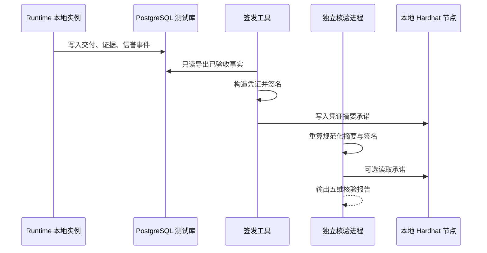

# 可验证信任层：原 Monad 能力复用、履约凭证与最小实验设计

此文归档设计期决策。实施后的 PoC、Trust Core 与 SDK V0.1–V0.3 见 [版本资产](REPOSITORY-INDEX.md#八个阶段)。

本文件是研究与技术设计，供产品评审。当前分支 `feat/payathon-commerce` 保持冻结，产品代码、团队仓库、Cloudflare 部署、支付宝支付状态均未改动。评审确认后才创建 `experiment/verifiable-trust-layer` 开展最小实验。

## 结论摘要

原团队的 `CollaborationLedger.sol` 与 `packages/chain` 的规范化哈希、回执校验能力可以直接复用。`AgentLedger.sol` 的任务模型只覆盖三角色、单验收方、单次尝试，无法直接覆盖个人 V2 的订单、多步骤交付、支付关联与重试语义。Runtime 侧已经具备确定性 CSV 校验、证据留存与信誉事件，具备签发履约凭证所需的事实来源。

履约凭证采用规范化 JSON 加 secp256k1 签名的结构，只包含摘要与判定，不包含原始数据与支付凭证。第三方只需凭证文件、签发者公钥名单与可选链上读取地址即可核验。三种方案中，中心化数据库最低成本，签名凭证提供离线可核验，链上承诺额外提供公开时间与存在性证明。链上承诺的增量价值只在“外部主体需要在不信任 CrewTrace 服务器的情况下确认记录存在且未被替换”时成立，当前 Beta 尚未出现这类外部核验方，因此本轮不启动链上功能扩张。

最小实验不需要新增智能合约。现有 `CollaborationLedger` 可以按约定映射保存凭证摘要。只有当出现多签发方授权或公开撤销需求时，才讨论合约变更。

## 一、原 Monad 能力复用分析

### 1.1 `AgentLedger.sol` 的实际边界

[AgentLedger.sol](file:///Users/francis/Desktop/Monad%20黑客松/CrewTrace-reputation-v2/contracts/src/AgentLedger.sol) 定义了三个固定角色 `DATA / ANALYSIS / REPORT`，任务状态为 `OPEN / ASSIGNED / SUBMITTED / VERIFIED_PASS / VERIFIED_FAIL`，按 `(address, Role)` 累计通过数与失败数。

可以直接复用的部分是记录范式：`assignTask` 绑定 `runId`、`taskId`、`attempt`、`assignee`、`inputHash`、`criteriaHash`、`decisionHash`、`validator`；`submitArtifact` 由履约者提交 `artifactHash`；`recordOutcome` 由预设验收方提交 `passed` 与 `evidenceHash`；每个事件都带完整索引字段，合约拒绝同一尝试的重复结论，拒绝非指派者提交、拒绝非验收方记账。

只能用于原团队任务模型的部分有三处。第一，`assignTask` 要求 `attempt == 1`，链上不支持重试与重新指派，而 V2 的租约恢复与有限重试会产生 `attempt > 1`。第二，角色是编译期枚举，无法表达 `csv-source-inspection`、`csv-data-review`、`csv-evidence-report` 这三个运行时步骤，也无法表达服务目录中的任意 `serviceId`。第三，`taskId` 在业务层由 `keccak256("co-vibe:csv-analysis-v1:" + runId + ":" + role)` 派生，绑定单一固定模板，无法容纳订单发起、买家验收与跨步骤证据数组。

无法覆盖 V2 商业履约的部分包括：订单与报价版本、买家身份、支付状态与支付凭证摘要、多步骤交付的证据集合、买家 `ACCEPTED / REJECTED` 决定与评分、规则版本、租约与超时。其中支付凭证、买家身份和金额属于不能上链的商业与个人信息。`AgentLedger` 还把 `artifactURI` 与 `evidenceURI` 写入链上，公开链上会暴露指向交付内容的地址；凭证设计需要避免这种做法。

链上信誉计数器与 V2 的 PostgreSQL 信誉事件是两套事实来源。当前 Runtime 使用 `experiment_reputation_events` 按 `(agent_id, role, outcome)` 聚合，公式为 `(PASS+1)/(PASS+FAIL+2)`，并叠加能力过滤与负载。两套计数同时作为权威来源会产生不可调和的偏差，设计上只保留一套可核验来源。

### 1.2 `CollaborationLedger.sol` 的实际边界

[CollaborationLedger.sol](file:///Users/francis/Desktop/Monad%20黑客松/CrewTrace-reputation-v2/contracts/src/CollaborationLedger.sol) 是通用承诺账本，保存 `kind`、`recordId`、`version`、`contentHash`、`uri`、`recorder`、`recordedAt`，同一 `(kind, recordId, version)` 拒绝重复写入。它不校验业务语义，只保证写入唯一与可回读。

这份合约适合承载履约凭证摘要。可复用的是：写入唯一性、按版本读取、事件中的 `contentHash` 与 `recordId` 索引、部署区块之后的存在性判断。限制是：`recorder` 是单一地址，链上只能证明“该地址提交过这个摘要”，不能证明摘要由谁签发；没有撤销字段；`Kind` 枚举只有 `AGENT / TASK / PROPOSAL / CLAIM / HANDOFF`，没有履约凭证类型；`uri` 必须非空，写入时必须使用不泄露数据的标识。

### 1.3 链适配器与回执校验

[collaboration.ts](file:///Users/francis/Desktop/Monad%20黑客松/CrewTrace-reputation-v2/packages/chain/src/collaboration.ts) 提供 `canonicalJson`、`hashCollaborationDocument`、`deriveCollaborationRecordId`、`record`、`status`、`waitConfirmed`、`getCommitment`。其中规范化 JSON 排序后做 keccak256、`finalized` 区块判定、按指定区块回读承诺，都可以直接用于凭证核验。

[receipts.ts](file:///Users/francis/Desktop/Monad%20黑客松/CrewTrace-reputation-v2/packages/runtime-chain/src/receipts.ts) 的 `assertAssignmentReceipt`、`assertSubmissionReceipt`、`assertOutcomeReceipt` 逐字段比对回执与预期输入，校验 `chainId`、`contract`、`signer`、事件唯一性、`eventId` 格式。该模式可以直接移植到凭证锚定回执，事件名与字段需要按新用途定义。

`hashFileBytes` 对持久化字节做 keccak256，符合“每端不重新序列化”的约束。现有 CSV 校验器 [csv-delivery.ts](file:///Users/francis/Desktop/Monad%20黑客松/CrewTrace-reputation-v2/workers/src/csv-delivery.ts) 使用 sha256 十六进制摘要，与链上 keccak256 不一致；凭证需要同时保留规则引擎原始输出与统一摘要，避免两套摘要混用。

### 1.4 当前 Runtime 的可复用事实

[commerce.ts](file:///Users/francis/Desktop/Monad%20黑客松/CrewTrace-reputation-v2/services/runtime/src/commerce.ts) 的交付组装逻辑从已验收步骤读取 `content`，用 `hashUtf8` 计算内容摘要，并保留 `role / agentId / claimId / handoffId / contentHash` 证据数组。买家验收时写入 `acceptance`，其中 `reputation` 项标注 `source: DETERMINISTIC_REVIEW` 或 `NOT_TRACKED`。

[collaboration.ts](file:///Users/francis/Desktop/Monad%20黑客松/CrewTrace-reputation-v2/services/runtime/src/collaboration.ts) 在 CSV 数据清洗步骤验收通过时，把证据与复算结果比对后才写入 `experiment_reputation_events`，并且要求验收人与交付人不同。这条“确定性复算后记账”的路径是履约凭证最可靠的事实来源。

### 1.5 复用分类结论

| 能力 | 分类 | 说明 |
| --- | --- | --- |
| `CollaborationLedger` 承诺写入与回读 | 直接复用 | 用于凭证摘要锚定，不需要改合约 |
| 规范化 JSON 与 keccak256 | 直接复用 | 签发端与核验端共用同一实现 |
| `finalized` 区块快照读取 | 直接复用 | 避免未确认交易被当作证据 |
| 回执逐字段校验 | 直接复用 | 事件名与字段按凭证用途重新定义 |
| `AgentLedger` 指派、提交、验收事件结构 | 部分复用 | 结构可参考，角色与尝试约束不适用 |
| `AgentLedger` 三角色枚举与 `attempt == 1` | 仅原任务模型 | 无法表达 V2 步骤、重试与服务目录 |
| `AgentLedger` 链上信誉计数 | 不采用为权威 | 与 Runtime 信誉事件重复 |
| 链上 `artifactURI / evidenceURI` | 不采用 | 公开链上会泄露内容地址 |
| Runtime 确定性校验与证据留存 | 直接复用 | 作为凭证的 `validation` 与 `review` 来源 |
| 订单、支付、买家验收 | 无对应能力 | 必须留在链下 |

## 二、可验证履约凭证技术规格

### 2.1 设计目标

凭证要回答四个可分离的问题：这份记录由谁签发，内容是否被改动，签发者是否被信任，对应的链上承诺是否存在。凭证不回答“任务质量是否合格”，质量只能由确定性规则复算或验收记录说明。

### 2.2 数据结构

```ts
interface FulfillmentAttestationV1 {
  attestationVersion: 'ct-attestation-v1';
  attestationId: string;              // UUIDv4，签发端生成
  issuedAt: string;                   // 带时区 ISO-8601

  issuer: {
    issuerId: string;                 // 例如 'crewtrace-runtime'
    signerAddress: string;            // secp256k1 地址
    keyId: string;                    // 密钥轮换标识
  };

  subject: {
    agentId: string;                  // 履约者的签名地址或匿名主体标识
    role: string;                     // 例如 'csv-data-review'
    serviceId: string;                // 服务目录标识
    serviceVersion: number;
  };

  task: {
    taskId: string;
    attempt: number;                  // >= 1
    workflowVersion: string;          // 例如 'csv-workflow-v1'
  };

  order?: {
    orderRef: string;                 // keccak256(salt + ':' + orderId)
    buyerRef: string | null;          // keccak256(salt + ':' + buyerAgentId)
  };

  input: {
    contentHash: string;              // keccak256(持久化原始 UTF-8 字节)
    rowCount: number;
    schemaVersion: string;
  };

  delivery: {
    contentHash: string;              // keccak256(交付字节)
    deliveryVersion: number;
    rowCount: number;
  };

  validation: {
    ruleId: string;                   // 例如 'csv-ledger'
    ruleVersion: string;              // 例如 'csv-ledger-v1'
    result: 'PASS' | 'FAIL' | 'UNRESOLVED';
    checkCodes: string[];             // 仅检查项代码，不包含行值与金额
    checksDigest: string;             // keccak256(规范化检查项)
  };

  review: {
    decision: 'ACCEPTED' | 'REJECTED';
    reviewerAddress: string;
    reviewedAt: string;
  };

  reputation: {
    eventId: string;
    outcome: 'PASS' | 'FAIL';
    source: 'DETERMINISTIC_REVIEW';
  };

  payment?: {
    status: 'NOT_REQUIRED' | 'UNPAID' | 'VERIFIED';
  };

  chain?: {
    chainId: number;
    contract: string;
    commitmentKey: string;            // 合约内 commitmentKey
    txHash: string;
    blockNumber: string;              // 十进制字符串
  };

  integrity: {
    canonicalization: 'ct-canonical-json-v1';
    digest: string;                   // keccak256(去除 signature 后的规范化 JSON)
    signature: string;                // EIP-191 前缀后对 digest 签名
  };
}
```

`integrity.digest` 的计算范围排除 `integrity.signature` 自身。签发端与核验端都调用同一份 `canonicalJson`，不重新序列化持久化文件。

### 2.3 字段公开边界

| 字段 | 位置 | 理由 |
| --- | --- | --- |
| `attestationVersion`、`attestationId`、`issuedAt` | 可公开 | 凭证标识与时间 |
| `issuer`、`subject`、`task`、`serviceId` | 可公开 | 主体与任务标识，地址本身是匿名标识 |
| `orderRef`、`buyerRef` | 可公开摘要 | 加盐哈希，未授权方无法反推订单与买家 |
| `input.contentHash`、`rowCount` | 可公开 | 只暴露完整性摘要与规模 |
| `delivery.contentHash`、`deliveryVersion`、`rowCount` | 可公开 | 用于内容核验 |
| `validation.ruleId / ruleVersion / result / checkCodes / checksDigest` | 可公开 | 规则版本与检查项代码不含行数据 |
| `review`、`reputation` | 可公开 | 验收主体与信誉事件来源 |
| `payment.status` | 可公开 | 仅表示是否已支付 |
| `chain` | 可公开 | 承诺位置 |
| `integrity` | 可公开 | 签名 |
| 原始 CSV 输入与交付内容 | 仅链下 | 可能包含商户业务数据 |
| 订单号、买家 Agent 标识、金额、报价快照 | 仅链下 | 商业敏感信息，凭证只保存加盐摘要 |
| 支付凭证、`providerTradeNo`、`proofHash`、预下单编号、二维码链接 | 仅链下 | 支付凭证泄露可被冒用 |
| 支付宝账号、商户号、`service_id` 映射 | 仅链下 | 账号与商业配置 |
| 验收自由文本、评分评论 | 仅链下 | 可能包含个人信息 |
| 数据库主键、内部日志、IP、请求头 | 仅链下 | 运行细节 |
| 私钥、签名盐值 | 仅链下 | 密钥材料，盐值按需单独提供 |

加盐值由签发端保存在链下，通过受控通道提供给需要关联订单的审计方。核验凭证本身不需要盐值，因此公开凭证不会扩大订单可关联范围。

### 2.4 签名与信任根

签名算法使用 secp256k1，签名对象是 `keccak256(UTF8(canonicalJson(attestation 去除 signature)))` 的 EIP-191 前缀消息。核验端用 `recoverMessageAddress` 恢复地址，再与签发者名单比对。

签发者名单是独立配置文件，字段为 `issuerId`、`keyId`、`address`、`validFrom`、`validTo`、`revokedAt`。实验阶段把名单固定写入核验工具仓库，不通过 CrewTrace 服务实时获取，否则离线核验的独立性会被削弱。密钥轮换通过新增 `keyId` 完成，旧凭证继续用旧 `keyId` 核验。

`keyId` 与 `signerAddress` 的对应关系必须由名单校验。只比对地址而不校验 `keyId` 会允许攻击者复用合法 `keyId` 搭配自建密钥。

### 2.5 生命周期

签发发生在订单进入 `ACCEPTED` 之后。签发端读取已验收交付、证据数组与信誉事件，重新计算摘要，写入凭证文件并签名。凭证不修改订单状态，也不触发支付动作。

凭证一经签发不再修改。需要更正时签发新 `attestationId`，并在新凭证中通过可选字段引用被替代凭证；实验阶段不实现替代链，只保留“凭证不可变”的约束。

撤销在实验阶段不实现。若后续需要，撤销记录作为独立签名文档，包含 `attestationId`、`revokedAt`、`reasonCode`，核验端把撤销名单作为可选输入。

### 2.6 三方可做的核验

持有凭证与签发者名单的第三方可以完成：规范化 JSON 重算、摘要重算、签名恢复、签发者身份比对、`ruleVersion` 是否在已知集合中、链上承诺是否存在且摘要一致。持有原始交付文件的第三方还可以重算 `delivery.contentHash`，确认文件与凭证一致。

第三方无法仅凭凭证判断任务质量。质量结论来自 `validation.result` 这一被签名的声明，独立复核需要本地重跑同一 `ruleId` 与 `ruleVersion` 的规则。

## 三、三种信任方案比较

### 3.1 方案定义

A 方案只在 PostgreSQL 中保存履约记录，对外通过 HTTP 接口读取。B 方案在 A 之上签发签名凭证，凭证可以离线分发。C 方案在 B 之上把凭证摘要写入 Monad 承诺账本。

### 3.2 对比

| 维度 | A 中心化数据库 | B 签名凭证 | C 签名凭证加 Monad 承诺 |
| --- | --- | --- | --- |
| 跨组织信任 | 依赖对运营方的信任与接口可用性 | 依赖签发者名单，凭证可转发 | 依赖签发者名单与承诺记录，链本身不担保内容真实 |
| 独立验证 | 必须访问 CrewTrace 接口 | 可离线完成 | 可离线完成，链上部分需要读取节点或区块浏览器 |
| 可移植性 | 低，绑定服务 | 高，单文件可携带 | 高，凭证附带承诺位置 |
| 防篡改 | 由数据库权限与备份保证 | 签名覆盖全部字段 | 签名加公开摘要 |
| 事后替换检测 | 运营方可以改写历史且外部难以发现 | 单份凭证不可改，但签发方可以否认曾签发或对同一事实签发两份不同凭证 | 公开承诺使同一 `(kind, recordId, version)` 只能写一次，替换会被观察到 |
| 时间证明 | 依赖服务端时间戳 | 依赖签发端自报时间 | 区块提供独立时间下界 |
| 成本 | 最低 | 接近零 | 每次锚定产生链上交易费用，当前未实测 |
| 隐私 | 由接口权限控制 | 只含摘要与判定，选择性披露可控 | 只写摘要，公开链上看不到业务数据 |
| 运行复杂度 | 低 | 中，需要密钥管理与名单分发 | 高，增加签名账户、节点可用性、finality 等待与对账 |
| 故障影响 | 服务不可用即无法核验 | 服务不可用仍可核验 | 链不可用时可降级为 B 的离线核验 |

### 3.3 区块链的增量价值

链上承诺提供三项 A 与 B 都不具备的能力。第一，公开时间下界：任何人在凭证签发之后都可以确认该摘要早于某个区块存在。第二，写入唯一性：`CollaborationLedger` 对同一 `(kind, recordId, version)` 拒绝重复写入，替换同一记录会被公开暴露。第三，服务独立性：CrewTrace 服务下线或被收购后，外部仍能从链上读取承诺。

这些能力不覆盖内容真实性。链上只保存摘要，摘要由 `recorder` 地址提交，`recorder` 是中心化账户，因此链上记录证明“某个账户在某区块提交过这个摘要”，不证明“该履约真实发生”。凭证签名证明签发者作出了声明，名单决定是否信任该签发者。质量仍由确定性规则与验收记录决定。

增量价值成立的前提是存在不信任 CrewTrace 服务器的外部核验方，例如跨平台信誉聚合方、争议仲裁方或采购方合规审查。当前 Beta 的外部使用方式是匿名 MCP 与固定站浏览，尚无此类核验方。缺少这一前提时，B 方案已经满足“第三方离线核验”，C 方案增加成本与运维负担，收益无法证明。

### 3.4 不预设上链更优

如果核验方本身就是 CrewTrace 的合作方并愿意调用接口，A 方案成本最低。如果核验方需要离线验证单份记录，B 方案足够。只有当核验方需要在 CrewTrace 不配合的情况下确认记录存在且未被替换，C 方案才具备不可替代性。三种方案可以并存：默认签发 B，按需对高价值履约追加 C。是否追加应由外部需求触发，不能由技术偏好触发。

## 四、最小验证实验与验收标准

### 4.1 目标

一个独立第三方进程，在不持有 CrewTrace 数据库连接、不调用 CrewTrace 业务接口的条件下，对一份履约凭证给出可重复的核验结论，并能区分签名有效性、签发者身份、规则版本、链上承诺与任务质量五个维度。

### 4.2 环境与约束

实验在 `experiment/verifiable-trust-layer` 分支进行，使用本机隔离环境：现有 Runtime、独立 PostgreSQL 测试库、三个 CSV Worker，以及本地 Hardhat 节点上的 `CollaborationLedger`。链 ID 为 31337，仅本机可见。

签名密钥为实验专用本地密钥，保存在被忽略的 `.local/` 目录，与团队密钥、支付宝密钥、Cloudflare 凭据无关。链上交易只使用本地节点预置账户，不产生真实资金，不新增现金支出。

核验进程只读取三类输入：凭证文件、签发者名单、可选的链上读取地址。核验进程不得持有 `DATABASE_URL`，不得调用 CrewTrace 的 HTTP 或 MCP 接口。

### 4.3 实验步骤

第一步，用免费服务完成一笔真实本地订单，状态到达 `ACCEPTED`，取得交付内容、证据数组与信誉事件。第二步，只读导出这些事实，构造凭证并签名，输出 `attestation.json`。第三步，用同一份事实生成篡改样本与错误签发样本。第四步，在本地节点部署 `CollaborationLedger`，写入凭证摘要，输出 `chain.json`。第五步，在独立进程运行核验工具，输出机器可读报告与人类可读摘要。



### 4.4 用例矩阵

| 编号 | 输入 | 签名 | 签发者 | 规则版本 | 链上承诺 | 期望结论 |
| --- | --- | --- | --- | --- | --- | --- |
| 1 | 原始凭证，B 模式 | VALID | KNOWN | RECOGNIZED | ABSENT | `VERIFIED_OFFLINE` |
| 2 | 原始凭证，C 模式 | VALID | KNOWN | RECOGNIZED | PRESENT_MATCH | `VERIFIED` |
| 3 | 修改 `validation.result` | INVALID | 不适用 | 不适用 | 不适用 | `REJECTED` |
| 4 | 修改 `delivery.contentHash` | INVALID | 不适用 | 不适用 | 不适用 | `REJECTED` |
| 5 | 用名单外密钥重签 | VALID | UNKNOWN | RECOGNIZED | ABSENT | `REJECTED` |
| 6 | 保留合法 `keyId` 但替换地址 | VALID | KEY_MISMATCH | RECOGNIZED | ABSENT | `REJECTED` |
| 7 | 未知 `ruleVersion` | VALID | KNOWN | UNKNOWN | ABSENT | `INDETERMINATE` |
| 8 | 链上摘要与凭证摘要不同 | VALID | KNOWN | RECOGNIZED | PRESENT_MISMATCH | `REJECTED` |
| 9 | 链节点不可达 | VALID | KNOWN | RECOGNIZED | UNAVAILABLE | `VERIFIED_OFFLINE` 并标注链未核验 |
| 10 | 提供原始交付文件且摘要一致 | VALID | KNOWN | RECOGNIZED | 按模式 | 增加 `CONTENT_MATCH` |
| 11 | 提供原始交付文件但摘要不一致 | VALID | KNOWN | RECOGNIZED | 按模式 | `REJECTED` |

第七项返回 `INDETERMINATE`，不返回通过，因为规则版本未知时无法复现判定。第九项不把链不可用当作凭证无效，报告明确区分“签名与内容已核验”“链上承诺未核验”。

### 4.5 核验报告结构

```ts
interface VerificationReport {
  schema: 'VALID' | 'INVALID';
  signature: 'VALID' | 'INVALID';
  issuer: 'KNOWN' | 'UNKNOWN' | 'KEY_MISMATCH';
  ruleVersion: 'RECOGNIZED' | 'UNKNOWN';
  chainCommitment: 'ABSENT' | 'PRESENT_MATCH' | 'PRESENT_MISMATCH' | 'UNAVAILABLE';
  content: 'NOT_PROVIDED' | 'MATCH' | 'MISMATCH';
  quality: 'NOT_ASSERTED' | 'RECALCULATED_PASS' | 'RECALCULATED_FAIL';
  outcome: 'VERIFIED' | 'VERIFIED_OFFLINE' | 'INDETERMINATE' | 'REJECTED';
  reasons: string[];
}
```

`quality` 默认 `NOT_ASSERTED`。只有核验方本地重跑同一规则版本时才更新为 `RECALCULATED_PASS` 或 `RECALCULATED_FAIL`。链上承诺存在与签名有效都不改变 `quality`。

### 4.6 验收标准

十一条用例全部得到期望结论，任一不符即实验失败。核验进程在无数据库凭证、无 CrewTrace 业务接口访问的环境下完成全部用例，运行日志显示只读取凭证、名单与可选链节点。篡改样本不得通过。错误签发者不得被接受。未知规则版本不得返回通过。链上摘要不一致必须拒绝。报告必须区分“签名有效”“链上记录存在”“质量已复算”三种状态。

实验产物包括核验工具源码、十一条用例的输入文件、机器可读报告、运行命令与输出。原始 CSV 使用合成数据，不包含真实商户信息。

### 4.7 明确禁止

不使用团队私钥与团队链上账户。不向 Monad 测试网或主网写入交易。不调用支付宝接口。不修改 `apps/web`、`services/runtime`、`contracts` 的产品逻辑。不把实验密钥、盐值或数据库连接串提交到仓库。

## 五、信誉反馈研究

### 5.1 保留既有实验结果

30 任务实验使用固定种子 `crewtrace-v2-csv-2026-11-22`，三种策略处理同一批留出任务。信誉排序首次通过 30/30，能力过滤 24/30，随机 19/30；最终通过率信誉排序与能力过滤同为 30/30；信誉排序把任务集中到一名 Worker，重试为 0。

60 任务负载实验引入到达批次、中断窗口、冷启动与租约。随机策略首次通过 47/60、最终接受 59/60；能力过滤与信誉排序均为首次通过 44/60、接受 56/60，且两者在固定画像顺序下作出相同决策。随机策略在该工作负载上表现更好。

两组结果的共同结论是：样本由人工设计的缺陷类型构成，任务高度相似，没有真实并发与模型调用，单一随机种子不足以支持“信誉排序普遍优于其他调度方式”。本文件保留这两个反向结果，不删除，也不把 30 任务实验的集中分配解释为效率提升。

### 5.2 凭证与角色信誉的最小关联

关联键使用 `(subject.agentId, subject.role, subject.serviceId, validation.ruleVersion)`。信誉聚合只消费同时满足以下条件的凭证：`validation.result = PASS`，`review.decision = ACCEPTED`，`reputation.outcome = PASS`，且 `reputation.eventId` 在本地事件表中唯一。签名有效与链上承诺存在不直接增加信誉，只作为证据强度标记。

规则版本进入关联键，避免 `csv-ledger-v1` 与后续版本的成功率被混合成一个数字。服务标识进入关联键，避免不同服务的能力被互相借用。支付状态不进入信誉计算，防止通过付款购买信誉。

对外展示继续保留样本量，公式沿用 `(PASS+1)/(PASS+FAIL+2)`，无历史时为 0.5，并标注这是平滑估计，不代表真实成功概率。调度仍先做能力过滤，再按综合分排序，政策版本号随关联键变化而升级。

撤销与更正的凭证不删除历史事件，改为新增一条 `SUPERSEDED` 记录并在聚合时排除被替代凭证。实验阶段不实现该路径，只保留字段扩展空间。

### 5.3 尚未回答的问题

跨签发方的信誉能否合并，取决于不同签发方的规则版本与验收标准是否可比较，当前没有依据。凭证能否作为跨平台信誉载体，取决于对方是否接受同一签发者名单与规则定义，当前没有外部接受方。链上承诺能否降低争议处理成本，需要真实争议样本，当前没有。这些问题留待出现外部核验方后再评估。

## 六、代码增量范围

本轮代码增量为零，只新增本设计文档。

评审通过后的实验分支预计新增以下内容，全部位于独立目录，不进入产品运行路径：

| 路径 | 内容 | 是否影响现有产品 |
| --- | --- | --- |
| `packages/attestation/src/schema.ts` | 凭证类型与 Zod 校验 | 否 |
| `packages/attestation/src/canonical.ts` | 复用 `canonicalJson` 与摘要计算 | 否 |
| `packages/attestation/src/sign.ts` | 签名与地址恢复 | 否 |
| `packages/attestation/src/chain.ts` | 复用 `CollaborationLedgerClient` 写入与回读 | 否 |
| `packages/attestation/src/verify.ts` | 五维核验与报告 | 否 |
| `packages/attestation/cli/issue.ts` | 从本地只读事实生成凭证 | 否 |
| `packages/attestation/cli/verify.ts` | 独立核验命令行 | 否 |
| `packages/attestation/test/` | 十一条用例 | 否 |
| `docs/evidence/verifiable-trust/` | 报告与运行记录 | 否 |
| `experiments/verifiable-trust/fixtures/` | 合成 CSV 与篡改样本 | 否 |

实验分支不修改 `apps/web`、`services/runtime`、`workers`、`contracts`。订单事实通过只读查询导出，不新增运行时接口。若后续要把凭证签发并入 Runtime，需要单独评审接口、权限与幂等，不在本轮范围。

## 七、是否需要新增合约

最小实验不需要新增合约，也不需要修改现有合约。

`CollaborationLedger` 已经提供写入唯一性、按版本读取、事件索引与区块时间，足以承载凭证摘要。凭证类型可以通过 `recordId` 的派生前缀区分，例如 `deriveCollaborationRecordId('ATTESTATION', attestationId)`，`kind` 使用现有枚举值并在凭证规格中固定映射。`uri` 写入 `urn:ct:attestation:<attestationId>`，不指向任何可下载内容，避免公开链上泄露地址。

现有合约的缺口是明确的：没有 `ATTESTATION` 枚举、没有多签发方授权、没有撤销字段、`recorder` 是单一账户。实验阶段的信任模型是“CrewTrace 提交摘要，签名与名单证明签发者”，这些缺口不影响实验结论。

出现以下任一需求时再讨论合约变更：需要多个独立签发方各自写入；需要公开撤销状态并可被第三方直接查询；需要按签发者索引而不依赖链下日志；锚定写入量超出单一 `recorder` 的运维模型。变更优先考虑在现有合约增加枚举值，其次才考虑独立注册合约。发起变更前必须先用实验证明外部核验方真实存在。

## 八、对当前 PRD 的影响

[PRD.md](file:///Users/francis/Desktop/Monad%20黑客松/CrewTrace-reputation-v2/PRD.md) 的以下表述需要评审后调整。本文件只提出建议，不修改 PRD。

| PRD 位置 | 当前表述 | 建议 |
| --- | --- | --- |
| 03 验收口径 | 每条被计入信誉的结果均有链上回执和证据文件 | 改为每条信誉事件有签名履约凭证，链上承诺按外部需求启用 |
| 05 链上履历账本 | 链上保存身份、指派、产物承诺、验收结论 | 明确链上只保存摘要与承诺，原始交付、支付凭证、买家信息留在链下 |
| 04 信誉来源 | 按 `agentId + role` 统计 | 增加 `serviceId` 与 `ruleVersion` 维度，支付状态不进入信誉 |
| 04 去中心化边界 | 链上保存谁作出什么判断及其证据摘要 | 保留，并补充链上不证明任务质量 |
| F08 公开可审查 | 公网前端、合约地址、真实交易、结果文件 | 增加第三方离线核验入口，作为研究项而非 P0 |
| F07 第二轮再分工 | 读取第一轮链上证据 | 改为读取第一轮可核验凭证，链上承诺可选 |
| ERC-8004 | 不进入关键路径 | 保持不变 |

PRD 中“真实交易”与“链上回执”在当前 Beta 均未达成：`chain.configured=false`，收费链路停在 `PAYMENT_NOT_CONFIGURED`。研究结论不改变这些事实，也不把它们包装成已完成。

## 九、风险与停止条件

### 9.1 风险

数据泄露风险来自凭证字段设计。把 `artifactURI`、`evidenceURI`、订单号或支付凭证写入公开凭证，会让第三方通过凭证获取业务数据。控制方式是字段白名单加公开边界表，签发端拒绝任何未列入白名单的字段。

密钥风险来自签发者私钥集中。签发密钥一旦泄露，攻击者可以伪造任意履约凭证。控制方式是独立密钥、按 `keyId` 轮换、名单中保留撤销时间，实验阶段密钥只存在于本机被忽略目录。

规范化风险来自不同实现的 JSON 序列化差异。控制方式是签发与核验共用同一实现，并用固定测试向量校验。

规则版本风险来自规则变更后旧凭证被错误解释。控制方式是把 `ruleVersion` 纳入核验与信誉关联键，未知版本返回 `INDETERMINATE`。

证据强度误导风险来自把“签名有效”解读为“任务合格”。控制方式是报告中把 `quality` 与 `signature` 分开，界面与文档都不使用“已验证质量”这类表述。

测试数据风险来自公网体验仍使用测试库。当前数据库为 `crewtrace_v2_test`，包含 265 个订单、336 条信誉事件，任何外部核验都应标注数据来源为测试环境。

运行身份风险来自前端、Runtime 与仓库 HEAD 三者不一致。固定站产物来自 `b7786bd`，Runtime 报告的 `deployment.sha` 为 `4e4baa5`，仓库 HEAD 为 `e7d51b0`。证据文件必须同时记录三者，不能只引用其中一个。

共享材料风险来自团队共享文档中的个人账号标识与临时隧道地址。`docs/payathon-precheck.md` 含个人支付宝邮箱与 Cloudflare 账号 ID，`docs/v2-showcase-deployment.md` 含同一账号 ID，`docs/beta-freeze/beta-acceptance.md` 含当前 Quick Tunnel 主机名。共享前需要脱敏，隧道地址在重启后失效但仍应在对外材料中替换为通用说明。

外部 MCP 客户端能力受限风险来自公网隐藏 20 个工具。匿名调用方无法创建运行、指派任务或直接审阅交接，第三方核验不能依赖公网 MCP 的写入工具。核验实验使用独立命令行，不依赖 MCP 权限。

### 9.2 停止条件

| 条件 | 处理 |
| --- | --- |
| 独立核验必须调用 CrewTrace 业务接口才能完成 | 停止链上扩张，退回 A 或 B 方案 |
| 凭证要包含原始交付、支付凭证或买家身份才能成立 | 停止设计，重新划定公开边界 |
| 链上锚定需要团队私钥或付费服务 | 停止 C 方案，保留 B 方案 |
| 实验显示 B 方案已满足全部外部核验场景 | 不启用链上功能，把 C 方案列为待触发能力 |
| 无法获得稳定的外部核验需求方 | 不投入链上运维，只保留凭证签发能力 |
| 十一条用例任一不通过且无法定位原因 | 停止实验，不进入产品集成 |

### 9.3 当前不执行的事项

不修改团队仓库 `songconmaisaix31-design/CrewTrace`。不修改 Cloudflare 部署与固定站配置。不开启支付宝支付，`PAYMENT_MODE` 保持 `disabled`。不重构现有前端。不创建实验分支，不新增智能合约，不产生链上交易。

## 十、实施前补充设计

### 10.1 签发者信任模型与可信名单

实验采用固定名单作为唯一信任根。名单文件包含 `issuerId`、`keyId`、`address`、`validFrom`、`validTo`、`revokedAt`，随核验工具一同分发，核验时不从 CrewTrace 服务获取。名单的权限来源是实验发起人，变更通过仓库提交记录留痕；实验阶段不引入多签或链上治理。

核验端只承认同时满足以下条件的签发者：`issuer.issuerId` 与 `keyId` 在名单中存在且组合唯一；签名恢复地址等于名单中的 `address`；`issuedAt` 落在 `[validFrom, validTo]`；`revokedAt` 为空。名单缺失、组合重复或地址不一致都返回不可信，不按“最接近匹配”继续。

### 10.2 keyId、签名地址与身份的绑定

`keyId` 是密钥轮换标识，`address` 是 secp256k1 地址，两者在名单内一对一绑定。核验端同时校验三者：名单中的 `keyId`、名单中的 `address`、签名恢复出的地址。只校验地址会允许攻击者复用合法 `keyId`；只校验 `keyId` 会允许替换密钥。

`subject.agentId` 是 Runtime 内部 UUID，`subject.identity.namespace` 区分 `ct-local` 与 `eip155`。`ct-local` 表示本地身份，不可跨平台解读；`eip155` 表示链上地址，`identity.value` 为该地址。`signingAddress` 为可选字段，只有履约者持有签名密钥时才填写。验收人使用 `reviewerId` 与可选的 `reviewerAddress`，核验端要求验收人与履约主体不同。

### 10.3 有效期、撤销与密钥轮换

凭证包含 `expiresAt`，为空表示长期有效。实验签发的凭证有效期为签发后 365 天。核验端在 `issuedAt > expiresAt` 时返回过期。

撤销通过独立撤销名单完成，条目为 `attestationId`、`revokedAt`、`reasonCode`。名单由签发方维护并按需分发，核验端把它作为可选输入。未提供撤销名单时报告 `revocation: NOT_CHECKED`，结论不得为完全可信。

密钥轮换通过新增 `keyId` 完成，旧条目保留并设置 `validTo`。密钥被撤销时，该密钥签发的全部凭证返回 `KEY_REVOKED`。实验阶段不实现“撤销前签发仍然有效”的细化规则，避免给出无法验证的安全承诺。

### 10.4 attestationId 与 reputationEventId 的独立唯一性

`attestationId` 为 UUIDv4，由签发端生成并写入签发日志。`reputation.eventId` 来自 Runtime 的信誉事件，与本字段分属两个命名空间，不允许互相代替。签发日志按 `attestationId` 与 `reputation.eventId` 分别建立唯一约束，同一信誉事件不得签发第二份有效凭证。

信誉聚合按 `reputation.eventId` 去重，重复凭证只计一次。该约束在聚合函数中实现，并通过测试验证。

### 10.5 跨平台身份与本地 agentId

本轮只使用 `ct-local` 身份。跨平台身份映射涉及外部命名空间、所有权证明与争议处理，当前没有实现，也不在凭证中宣称。`subject.agentId` 只在本 Runtime 内有意义，外部核验方应把 `identity` 字段当作不透明标识。若后续引入 `eip155` 身份，需要新增地址所有权签名，不能仅凭字段声明。

### 10.6 规范化序列化、签名域隔离与防重放

规范化规则为 `ct-canonical-json-v1`：对象键按字典序、数组保持原序、不保留空白、拒绝 `undefined`。摘要为 `keccak256(UTF8("ct-attestation-v1:" + canonicalJson(payload)))`，`payload` 排除 `integrity` 与 `chain.receipt`。版本字符串同时进入摘要与凭证字段，用于隔离凭证签名与其他消息签名。

签名域隔离依靠两层结构。第一层是凭证版本 `ct-attestation-v1`，写入被签名内容；第二层是 `binding.environment` 与 `binding.deployment`，区分本地、预发布与生产部署。签名消息使用 EIP-191 前缀，签名用途与支付、链上交易签名分开。

防重放依靠 `attestationId` 唯一、`expiresAt` 有效期、`chain.chainId` 与 `chain.contract` 进入摘要。跨网络重放会改变摘要或导致链上合约不匹配；跨部署重放会改变 `binding.deployment`。`chain.receipt` 不进入签名，因为它由链上事件独立核验，伪造回执会在读取阶段失败。

### 10.7 链上承诺的网络、合约与记录绑定

链上部分固定绑定 `chainId`、`contract`、`mappingKind`、`recordId`、`version` 与 `commitmentKey`。实验复用 `CollaborationLedger`，`mappingKind` 取合约现有枚举中的 `HANDOFF`（数值 4），并在凭证中显式写出该映射，避免核验端猜测。`recordId` 为 `keccak256(UTF8("co-vibe:collaboration:ATTESTATION:" + attestationId))`。`version` 固定为 1。`uri` 为 `urn:ct:attestation:<attestationId>`，不指向可下载内容。

核验端重算 `recordId` 与 `commitmentKey`，读取链上承诺，要求 `contentHash` 等于凭证摘要、`recordId`、`version`、`kind` 与合约地址一致。任何一项不符返回 `PRESENT_MISMATCH`。

### 10.8 加盐摘要的隐私与关联风险

`orderRef` 与 `buyerRef` 使用 `keccak256(UTF8(salt + ":" + value))`，盐值为 32 字节随机数，按签发周期轮换，只保存在链下。凭证不包含盐值，因此未授权方无法反推订单号与买家标识。

风险有三点。盐值泄露会让同一周期内的全部引用可关联；订单号若为低熵值，攻击者可在拿到盐值后枚举；同一盐值跨周期复用会扩大关联范围。控制方式是每周期新盐、盐值仅通过受控通道交给审计方、凭证不包含任何可枚举的原始标识。

## 十一、待评审决定

需要产品评审确认三件事：履约凭证的字段白名单是否覆盖商业核验需要；是否接受“链上承诺按外部需求启用”的默认策略；最小实验的十一条用例与验收标准是否足够。确认后再创建 `experiment/verifiable-trust-layer`，按第六节范围实施。
